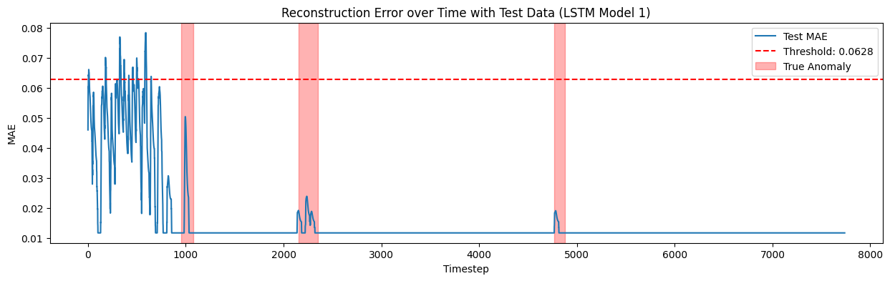

# Time-Series Anomaly Detection

This project explores **unsupervised anomaly detection in time-series data** using two LSTM autoencoders and a One-Class SVM. Using NASA's telemetry dataset, I compared how different approaches identify unusual patterns in sequential data.

## Approach

- **Data preprocessing:** Scaled the telemetry data using Min-Max scaling and created sliding windows of 45 timesteps.
- **LSTM Autoencoders:** Built and trained two neural network architectures to reconstruct normal time-series patterns, using reconstruction error to flag potential anomalies.
- **One-Class SVM:** Extracted statistical features from each window and used an RBF-kernel One-Class SVM to identify anomalous observations.
- **Evaluation:** Compared model performance using F1-score, precision, recall, and ROC-AUC against NASA's labelled anomaly intervals.

## Results

The One-Class SVM outperformed both LSTM autoencoders in this experiment. At the selected reconstruction-error thresholds, the LSTM models achieved zero precision, recall, and F1-score, despite obtaining ROC-AUC scores above 0.68.

| Model | F1-score | Precision | Recall | ROC-AUC |
|---|---:|---:|---:|---:|
| LSTM Autoencoder 1 | 0.0000 | 0.0000 | 0.0000 | 0.6851 |
| LSTM Autoencoder 2 | 0.0000 | 0.0000 | 0.0000 | 0.6826 |
| One-Class SVM | 0.6259 | 0.7797 | 0.5227 | 0.7825 |

## Visual Results

<!-- Add your model evaluation plot below -->

*Reconstruction error over time, with the selected anomaly threshold and labelled anomaly intervals.*

## Key Takeaway

This experiment highlighted the importance of evaluating anomaly detection models beyond their reconstruction loss. Although the LSTM autoencoders learned to reconstruct the training sequences, their selected thresholds did not successfully classify the labelled anomalies, as the recosnstructon errors in non-anomalous areas were muhc higher. The One-Class SVM achieved a better balance between precision and recall in this experiment.

## Technologies

Python · TensorFlow/Keras · NumPy · Pandas · Scikit-learn · Matplotlib · Seaborn
